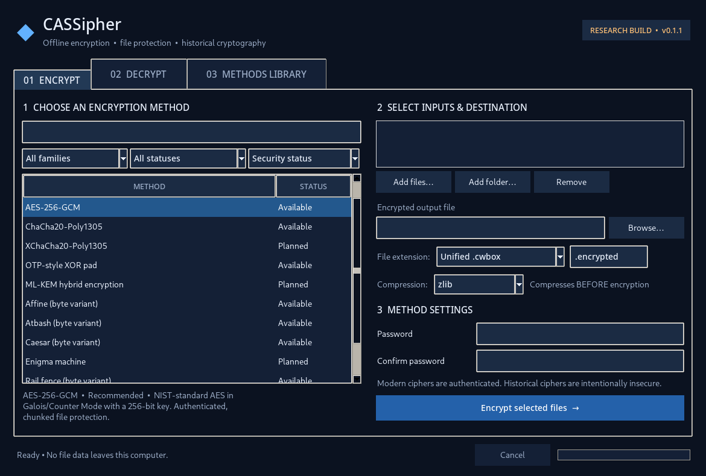
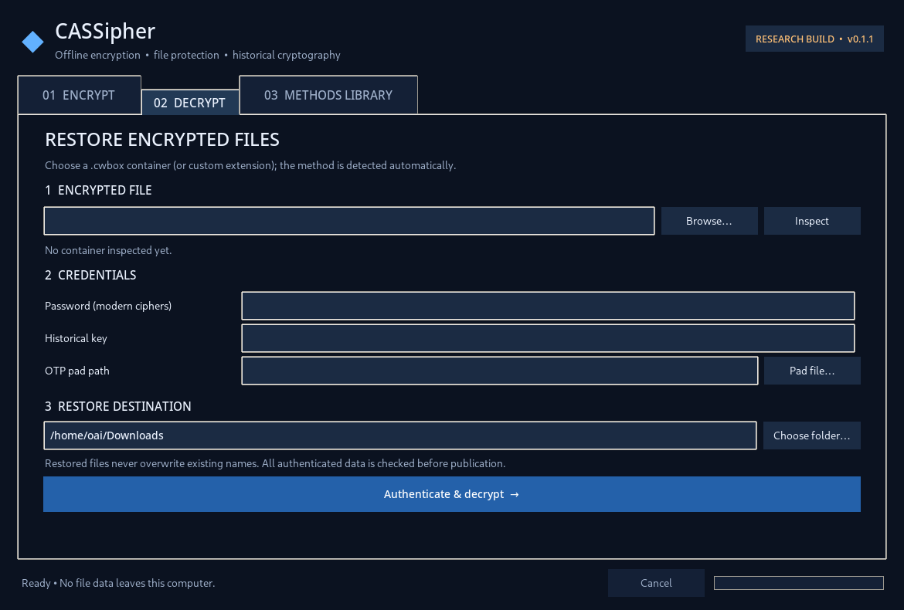
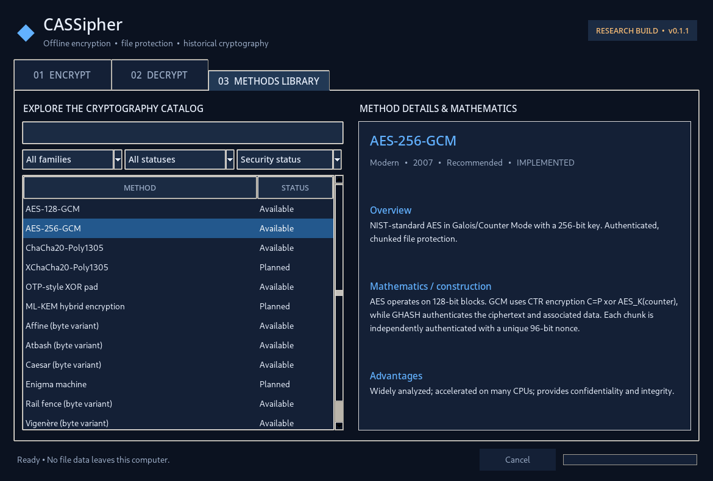

# CASSipher

*Cassander Cipher — Windows encryption and historical and modern cryptography workbench.*

**Offline Windows file encryption, decryption, compression, and classical cryptography laboratory**  
**Version:** 0.1.1 



> [!WARNING]
> This is an experimental application and custom file format. Do **not** entrust irreplaceable or highly sensitive material to it without independent review. **Encryption and decryption can create temporary plaintext archives on disk** and deletion of those temporary files is not secure erasure. Back up your originals and important key material. This project is not a replacement for independently reviewed tools such as age, GnuPG, or established full-disk encryption.

## Features available **today**

- Three tabs: **Encrypt**, **Decrypt** (automatic algorithm detection), and **Methods Library** (history, pros/cons, mathematics, availability).
- Browse for files/folders; multi-file packages; choose encrypted file and restoration location; optional drag-and-drop if `tkinterdnd2` is installed.
- Password-based **AES-256-GCM**, **AES-128-GCM**, **ChaCha20-Poly1305**. KDF: **Argon2id**, 64 MiB, 3 passes, 2 lanes.
- Authenticated, chunk-based encrypted file records for large files, including a final completion record; authenticated header. **No input files are overwritten.**
- Byte-adapted **Caesar**, **Atbash**, **Vigenère**, **Affine**, and **Rail fence** educational ciphers, explicitly labeled insecure. Rail fence is capped at 16 MiB of packed bytes.
- OTP-style XOR pad with random pad-file generation, independent 32-byte HMAC-SHA256 key material and **local pad-use ledger**. See important limitations below.
- Compression before encryption: `zlib`, `lzma`, `bz2`, no compression, **optional** `zstd`, and `auto` (tries available codecs and selects the smallest file; slower and requires scratch disk space).
- Native `.cwbox` format with metadata sufficient to identify algorithm, compression, and restoration method (secret keys not embedded).
- Optional custom output extension or original-looking extension (file bytes remain CWBOX regardless of extension).
- Source launcher and CLI; automated tests; GitHub Actions testing and Windows EXE packaging.

**Not yet implemented:** XChaCha20-Poly1305, ML-KEM, OpenPGP/age interoperability, Enigma simulation, recipient-based encryption, layered pipeline builder, post-encryption compression, hardware key storage, secure wipe, or a signed installer. These appear as **Planned** in the catalog, not as working buttons. Android is not a current target.

## Renaming from Cipher Workbench (v0.1.0)

The project and Python module are now called **CASSipher**. The native `.cwbox` extension and `CWBOX1\r\n` internal magic deliberately remain unchanged: **files encrypted with the earlier release remain decryptable**. The existing local OTP pad-use ledger is also retained at its legacy location to prevent previously used pads from being accepted as new after upgrading. Do not delete or reset that ledger.

## Requirements — Windows

- 64-bit **Windows 10 or 11**.
- **Python 3.11+**, with Tkinter enabled (included in the standard python.org Windows installer).
- A small set of Python dependencies. VS Code is optional.

### Start in Windows Command Prompt / VS Code terminal

Unzip the project to a directory. The easiest first-time setup is to double-click `setup_windows.bat`, then double-click `run_windows.bat` whenever you want to launch the application. Alternatively, open a terminal **inside the project directory** and enter:

```powershell
python -m venv .venv
.venv\Scripts\activate
python -m pip install -r requirements.txt
python main.py
```

For **Zstandard compression** and **drag-and-drop** support:

```powershell
python -m pip install zstandard tkinterdnd2
```

Your original Python programs remain unaffected because dependencies are installed into `.venv`. If `python` does not work, try the Windows Python launcher (`py`) instead.

### Windows executable 
exe file have been released.

## Using the application

### Encrypt

1. Select an **Available** algorithm. For real-file confidentiality, select AES-256-GCM, AES-128-GCM, or ChaCha20-Poly1305.
2. Add files and/or folders.
3. Choose output file. Default `.cwbox` is recommended; file contents remain CWBOX even with another extension.
4. Choose compression; enter and confirm a passphrase (at least 10 characters for modern algorithms).
5. Click **Encrypt selected files**. Original files remain unchanged. Do not delete originals until you have tested decryption and backed up keys.

For **OTP-style XOR**, select a separate path for a new pad file. The pad is secret, is usually approximately as large as the compressed archive, and must **never be reused**. To use an existing *unused* pad, uncheck Generate New and select a keyfile with the exact required size. The app maintains a local registry to reject known reuse on the same device; it cannot detect key reuse on another machine or after registry deletion. Losing the pad makes recovery impossible.

### Decrypt

1. Open the .cwbox file (even if it has a different extension).
2. Press **Inspect** to read the *unauthenticated public header*. The application automatically detects the method.
3. Supply password, historical key, or OTP pad as appropriate.
4. Select a destination folder and **Authenticate & decrypt**.
5. For a single packaged file it restores a new file directly; for multiple files/folders it creates a new `*_restored` folder. Existing paths are never intentionally overwritten.

The public header is not proof that a file is authentic. Authenticity for a modern container is established only after successful full decryption. Historical mode has only an unkeyed checksum, so modification can be forged.

### Method library

Search and filter the available and planned algorithms. Each page includes construction, mathematics, strengths, weaknesses, key requirements and approximate performance category. Speed categories are **qualitative, not benchmark measurements**.





## Optional command-line tool

Install the package in editable mode:

```powershell
python -m pip install -e .
python -m cassipher.cli methods
python -m cassipher.cli encrypt "C:\path\my-file.txt" -o "C:\path\my-file.cwbox" -m aes256 -c zlib
python -m cassipher.cli inspect "C:\path\my-file.cwbox"
python -m cassipher.cli decrypt "C:\path\my-file.cwbox" -o "C:\path\restored"
```

Password prompts use `getpass` rather than arguments, avoiding command-line password disclosure. Avoid supplying secret passwords on a command line or storing them in scripts.

## Running tests

```powershell
python -m pip install -e .
python -m unittest discover -s tests -v
```

Tests cover multiple authenticated algorithms, compression methods, large files, Unicode filenames, batch archives, historical transforms, OTP output and reuse prevention, modified/truncated containers, empty input, cancellation, no-overwrite behavior, and archive traversal protection. This is not a formal audit. See [TESTING.md](docs/TESTING.md).

## Security properties and limitations

**What modern encryption provides:** AEAD confidentiality and authentication of the payload and header once the password-derived key is correct, per-chunk unique nonce construction, explicit authenticated end marker, Argon2id password derivation, and failure without publishing incomplete decryption output.

**What it does NOT provide:** protection against a compromised endpoint, weak passwords, compromised backup copies or keys, plaintext remanence in disk temporary storage, side channels, metadata traffic analysis, a formal proof of composition, or guarantees expected of independently audited cryptographic software.

* The app packages files into a **plaintext temporary ZIP_STORED** archive and then compresses it into another temporary file before encrypting; decrypting also temporarily creates plaintext data. The operating system may preserve deleted bytes in filesystem snapshots, SSD wear-leveling, or crash artifacts. Avoid high-sensitivity workloads until the planned direct streaming refactor is complete.
* The internal ZIP is used strictly for packaging; output itself is our **custom format**, not ZIP, OpenPGP, or age.
* Compression may reveal structure through the total encrypted size. Avoid mixing attacker-supplied and secret data in interactive applications.
* Modern algorithms require users to store or remember their passphrases. **There is no password recovery mechanism.**
* Historical algorithms are explicitly **BROKEN** and are unauthenticated. They are for education, not protection.
* The OTP-style implementation uses OS cryptographic **pseudorandom** bytes and HMAC-SHA256, so it **does not claim mathematical perfect secrecy or unconditional authenticity**.
* Random-pad usage is tracked **locally** only; it cannot be synchronized across devices. Canceled OTP operations burn the reserved pad.
* Inspect metadata is not authenticated until decryption succeeds. Algorithm/method/compression and approximate payload size are publicly visible.
* File paths can reveal sensitive names in the local UI. Filenames stored in the encrypted internal ZIP are protected under modern AEAD encryption.

See [SECURITY.md](SECURITY.md), [the CWBOX format](docs/FORMAT.md), and [the development roadmap](docs/ROADMAP.md).


## License and dependencies

Project source is licensed under the [MIT License](LICENSE). Bundled dependencies retain their respective third-party licenses; see [DEPENDENCIES.md](docs/DEPENDENCIES.md). The `cryptography` project, Tk/Tcl, optional `zstandard`, and `tkinterdnd2` have separate attribution and license requirements when distributing packaged binaries.

## Contributions

See [CONTRIBUTING.md](CONTRIBUTING.md). Please do **not** add newly invented production-grade ciphers or claim unreviewed algorithms are secure. Responsible vulnerability reporting goes through [SECURITY.md](SECURITY.md).
